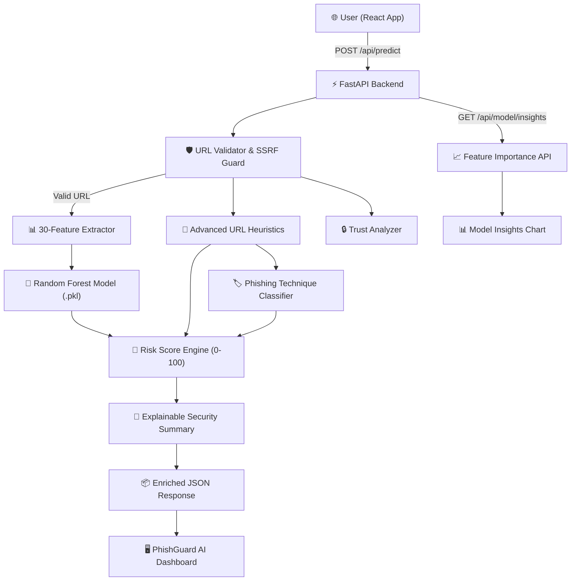

# PhishGuard AI — Real-Time AI Phishing Detection System

**PSN013 Hackathon Solution** | Web-based machine learning platform that analyzes user-submitted URLs in real time to predict phishing risk and deliver an explainable security intelligence report.

> ℹ️ **Security Policy Notice:** PhishGuard AI performs non-intrusive URL-level analysis strictly offline. The system **never** crawls, opens, downloads, or executes submitted websites.

---

## 📌 Problem Statement

Phishing remains one of the most prevalent and damaging cyber threats facing individuals and organizations worldwide. Attackers constantly create zero-day phishing links using brand impersonation, typosquatting, user-info `@` symbol tricks, open redirect parameters, and temporary URL shorteners to bypass traditional static blacklists. Users need an intelligent, real-time security tool that inspects link structures and provides clear, explainable risk assessments before they enter sensitive credentials.

---

## 💡 Solution: PhishGuard AI

**PhishGuard AI** combines a pre-trained **Random Forest Classifier** (trained on 11,055 samples from the UCI Phishing Websites dataset with **97.42% accuracy**) with an **Advanced URL Heuristic Engine** to evaluate 30 structural, domain, and protocol signals. Rather than outputting an unexplained binary prediction, PhishGuard AI calculates a deterministic **AI Risk Score (0–100)** and generates a comprehensive, human-readable **Explainable Security Report**.

---

## ✨ Key Features

- **AI-Powered Phishing Classification**: Evaluates raw URL syntax against a Random Forest model trained on 30 lexical and structural features.
- **Advanced URL Heuristic Engine**: Detects excessive URL length, subdomain depth, numeric-heavy hostnames, percent encoding obfuscation, and open redirect parameters.
- **Phishing Attack Technique Detection**: Categorizes detected URL threats into structured technique cards (`IP-Based URL`, `URL Shortening`, `Credential-Themed URL`, `Redirect Manipulation`, `URL Obfuscation`, etc.) with severity levels (`🔴 HIGH`, `🟠 MEDIUM`, `🟡 LOW`) and evidence snippets.
- **Deterministic AI Risk Score (0–100)**: Maps risk scores to 4 transparent risk levels (`LOW`, `MEDIUM`, `HIGH`, `CRITICAL`).
- **Explainable Security Summary**: Dynamically synthesizes concise, non-exaggerated security guidance for each scan.
- **Visual URL Breakdown**: Decomposes target URLs into color-coded segments (`Protocol` | `Domain` | `Resource Path` | `Query Parameters`). Submitted links are rendered in non-clickable code blocks for user safety.
- **7-Stage Detection Pipeline Visualizer**: Interactive cybersecurity workflow diagram outlining the complete evaluation lifecycle.
- **Scan History & Side-by-Side Comparison**: Stores up to 10 recent scans locally in `localStorage` with full report restoration and side-by-side metric comparison (Current Scan vs Previous Scan).
- **Model Transparency & Dataset Insights**: Displays actual training parameters from `model_metadata.json` (8,844 train / 2,211 test split, precision, recall, F1-score) and an interactive horizontal bar chart of Gini feature importances.
- **Safe Demo Examples Selector**: Populates harmless sample URLs (`https://example.com`, `https://www.example.org/login`, `http://example.com/account`) without auto-submitting.

---

## 🔄 End-to-End System Architecture



---

## 🛠️ Technology Stack

| Layer | Technologies / Frameworks |
| :--- | :--- |
| **Frontend** | React 19, Vite, JavaScript (ES6+), Vanilla CSS (Cybersecurity Dark Theme) |
| **Backend** | Python 3.14+, FastAPI, Uvicorn, Pydantic |
| **Machine Learning** | Scikit-learn (RandomForestClassifier - 200 estimators), Pandas, NumPy, Joblib |
| **Dataset** | UCI Phishing Websites Dataset (ID 327 - 11,055 instances, 30 features) |
| **Testing & Quality** | Pytest (43 unit & integration tests), FastAPI TestClient |
| **DevOps & Containers** | Docker, Docker Compose, Windows Batch Script (`run_project.bat`) |

---

## 🚦 Quick Start & Installation

### Option A: One-Command Startup (Windows)
Double-click `run_project.bat` or run:
```cmd
run_project.bat
```
This automatically launches the FastAPI backend on `http://127.0.0.1:8000` and the React frontend on `http://localhost:5173`.

---

### Option B: Manual Setup

#### 1. Start FastAPI Backend:
```powershell
cd backend
.\venv\Scripts\Activate.ps1
uvicorn app.main:app --reload --host 127.0.0.1 --port 8000
```
- **Health Check**: [http://127.0.0.1:8000/api/health](http://127.0.0.1:8000/api/health)
- **Interactive Swagger Docs**: [http://127.0.0.1:8000/docs](http://127.0.0.1:8000/docs)

#### 2. Start React Frontend:
```powershell
cd frontend
npm run dev
```
- **App URL**: [http://localhost:5173](http://localhost:5173)

---

### Option C: Docker Container Startup
```bash
docker-compose up --build
```
- Frontend Container: [http://localhost:5173](http://localhost:5173)
- Backend Container: [http://localhost:8000/docs](http://localhost:8000/docs)

---

## 🧪 Testing & Performance Benchmarks

### 1. Run Automated Test Suite (43 Unit & Integration Tests)
```powershell
.\backend\venv\Scripts\python -m pytest tests/
```
*Result: **43 / 43 Passed** (100% pass rate).*

### 2. Run Comprehensive Performance Benchmark
```powershell
.\backend\venv\Scripts\python tests/performance_benchmark_full.py
```
*Empirical Measurement Results:*
- Model Loading Time: `1201.46 ms`
- Single Prediction Time: `77.80 ms`
- 10 Sequential Predictions: `563.49 ms` (Avg `56.35 ms / request`)
- 100 URL Heuristic Analyses: `0.002 s` (Avg `0.016 ms / URL`)

---

## 🔒 Security & SSRF Safeguards

- **Zero Outbound HTTP Requests**: Analysis operates 100% locally on the submitted URL string. The server **never** fetches external page content, resolves arbitrary DNS targets, follows redirects, or executes JavaScript.
- **SSRF Protection**: `url_validator.py` rejects loopback (`127.0.0.1`), private IP ranges (`10.x.x.x`, `192.168.x.x`), cloud metadata endpoints (`169.254.169.254`), and unsupported protocols.
- **Non-Clickable Frontend Display**: Target URLs in the UI are rendered strictly inside non-clickable `<code>` elements without `href` links to avoid accidental clicks.
- **Security Headers**: All API responses attach `X-Content-Type-Options: nosniff`, `X-Frame-Options: DENY`, and `Referrer-Policy: no-referrer`.

---

## ⚠️ Limitations

- **URL-Level Analysis Scope**: Analysis is derived from URL lexical patterns and local feature extraction. Features dependent on HTML DOM state (e.g., `favicon`, `url_of_anchor`) utilize risk-aware static fallbacks.
- **HTTPS Does Not Guarantee Safety**: Attackers routinely obtain free SSL certificates for phishing domains. HTTPS encryption guarantees transport privacy, NOT domain legitimacy.
- **AI-Assisted Risk Predictions**: ML predictions output probabilistic risk scores and should be treated as risk indicators rather than absolute declarations of safety.

---

## 🔮 Future Enhancements

- **Graph-Based URL & Domain Relationship Mapping**: Visualizing domain infrastructure, shared IP subnets, and registrant links.
- **Threat Intelligence API Integration**: Enriching offline heuristics with live reputation feeds (e.g. VirusTotal, Google Safe Browsing).
- **Browser Extension**: Real-time background URL scanner for Chrome/Firefox.
- **Email Body Link Inspector**: Automatic extraction and risk scoring of URLs inside incoming emails.
- **Continuous Model Retraining**: Automated retraining pipeline triggered by newly discovered zero-day phishing datasets.
